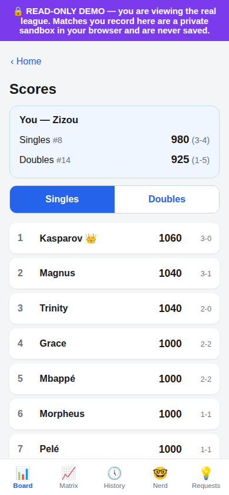
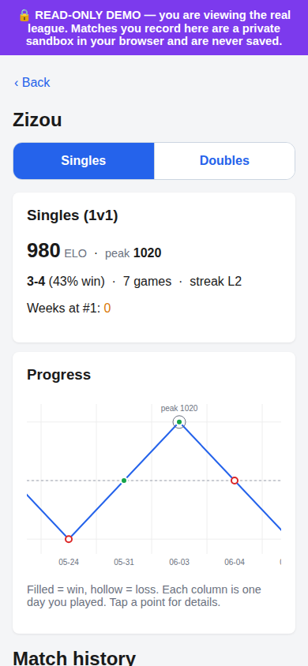
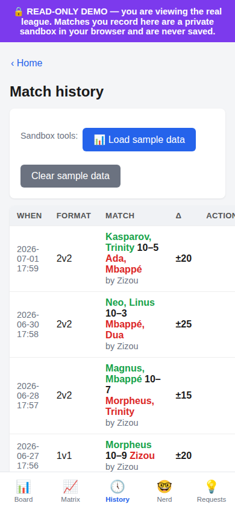

# Foosball Tracker

A minimal webapp for logging foosball (baby-foot) matches and tracking per-player
ratings and stats. Supports **1v1** and **2v2**. No passwords: pick your name
(honor system).

<p>



</p>

*Screenshots: the read-only demo mode on the bundled fake sample players.*

## Provenance

- **Original (July to August 2026):** written by Alex Huou for the office foosball
  table: rating model, stats, matrices, history edits, Nerd and Requests tabs,
  Telegram notifications, Vercel + GitHub-as-database hosting.
- **Added in October 2026 (AI-assisted, Claude Code):** the `READ_ONLY` viewer mode
  for a public deployment, the `tests/` suite, the screenshots above, and these docs.

- **Pure Python 3 standard library.** No pip, no external packages (`urllib` is used
  for the GitHub API).
- Target: Python **3.12+** (developed on 3.14).
- Storage is plain CSV, either on local disk (+ git) or in a private GitHub repo.

## Run it locally (zero config)

```bash
cd foosballTracker
python app.py
```

On startup it prints:

```
Serving on http://0.0.0.0:5000
LAN URL:    http://<your-lan-ip>:5000
```

It binds `0.0.0.0:5000`, so any device on the same network can reach it. On first run
it creates `data/players.csv`, `data/matches.csv`, and a `secret.key` (signs the login
cookie; **not** committed). No environment variables are needed in this mode.

**Connecting from other machines:** find the host's LAN IP (the app prints it, or run
`hostname -I`), then open `http://<that-ip>:5000/` on any phone/laptop on the same
network. If it won't connect, allow inbound TCP 5000 on the host firewall
(`sudo ufw allow 5000/tcp` on Linux).

## Read-only mode (public viewer)

Set `READ_ONLY=1` and the deployment reads the real data but can never change it:

```bash
READ_ONLY=1 python app.py          # local
# on Vercel: env var READ_ONLY=1 on a separate project (see HOSTING.md)
```

- Every visitor becomes a **sandbox (trial) session**: entering a name creates no
  player, and "Record a match" only adds to a private cookie, like Trial mode.
- All write controls (edit, delete, remove player, post/reply/status on requests,
  new-player seed ELO) are hidden, and their POST routes return **403**.
- Belt and braces: the store is wrapped in `ReadOnlyStore`, whose write methods raise,
  so a missed route fails instead of writing. A **read-only GitHub token** is therefore
  enough for this deployment.

## Tests

```bash
python3 -m unittest discover -s tests -v
```

Covers read-only mode (every write route refused, data files byte-identical after a
full attack, pages render real data with no write controls) and the rating maths
(gap buckets, zero-sum transfer, score-margin multiplier).

## Deploying (hosted, self-updating CSV on GitHub)

This app also runs on **Vercel** with **GitHub as the database**, every write commits
the CSV to a private data repo. See **[HOSTING.md](HOSTING.md)** for the full walkthrough
(create repos, fine-grained token, env vars). The short version is at the bottom of this
file.

## Features

- **Pick a name** (`/login`): a new name creates a player; existing names log you in.
  Names de-dupe case-insensitively, and inputs autocomplete against the known roster,
  snapping a typed name to its canonical casing. A signed cookie (`who`) remembers you.
- **Seed ELO at registration:** a new player enters their **starting rating** on the
  login form (default 1000, clamped 100–3000). Existing players are unaffected.
- **Record a match** (`/record`): 1v1 or 2v2, player slots backed by the roster
  datalist, two scores. Ties and duplicate players are rejected. After recording you
  get a **breakdown view** (see below).
- **Leaderboard** (`/`): ranked by rating, with **Peak** rating, W-L, win %, weeks-at-#1,
  streak, and games; plus a recent-matches feed.
- **Player page** (`/player?name=…`): full stats including **peak rating** and reign
  detail (`Weeks at #1: N (longest reign X, current Y)`) and match history.
- **Correlation matrices** (`/matrix`): a **partner-synergy** matrix (2v2 win% as
  teammates, with best/worst partnership lists) and a **head-to-head** matrix (win% as
  opponents). Heat-colored; cells with <2 games are faded.
- **Trial mode** (*Try it out*): a private sandbox. You see the real leaderboard as a
  base and can record experimental matches, all held in a **signed cookie**, visible
  only to you, wiped on logout, and never written to storage. **Load sample data**
  fills it with a deterministic demo dataset (14 players, 40 matches) so you can play
  with the stats display; **Clear sample data** resets it.

## Rating model (gap-bucketed point transfer)

Not classic Elo: an asymmetric system that rewards upsets and barely rewards favourites
for beating weaker opponents. Everyone starts at their **seed** rating (default 1000).

- **Sides:** in 1v1 a side's rating is the player's; in 2v2 it's the **average** of the
  two teammates.
- The higher-rated side is the **favourite**, the lower the **underdog** (a tie makes
  both favourite).
- The **rating gap** (absolute difference of side ratings) selects a bucket, giving each
  role a fixed point value **X**:

  | Gap | Favourite X | Underdog X |
  |-----|-------------|------------|
  | 0–50 | 20 | 20 |
  | 51–150 | 15 | 25 |
  | 151–300 | 10 | 30 |
  | 301+ | 5 | 35 |

- The match is a **zero-sum transfer**: the amount that moves is the **winner's** role X.
  The winning side **adds** it to each member and the losing side **subtracts the same
  amount** from each member. So an **upset** (underdog wins) moves the big underdog X both
  ways; an **expected win** (favourite wins) moves the small favourite X both ways.
  Doubles teammates move by the same amount. Score margin is ignored; there is no floor.
- Points are **conserved within a match** (winner gains == loser loses) but **not across
  matches** (X depends on the gap/outcome). The bigger the upset, the more points move.

**Example:** 1200 (fav) vs 1000 (under), gap 200 → favX 10 / underX 30. Favourite wins
(expected) → 1210 / 990 (moves 10). Underdog wins (upset) → 1030 / 1170 (moves 30).

**Per-match breakdown:** after recording, the result page shows each player's
old → new rating, their role (favourite/underdog), and the X applied, and for doubles,
the two team averages, the gap, and the category used.

**Replay-from-log:** the whole match log is **replayed from scratch** on every page load,
so ratings, peak, streaks, weeks-at-top, reigns, and matrices are always consistent with
the recorded history. Edit or rewind the CSV and everything recomputes.

**Weeks at #1:** a player needs ≥3 games to qualify as #1. Whoever is #1 (by rating among
qualified players) at the last match of each ISO week gets that week counted; longest/
current reign are the longest and trailing runs of consecutive weeks held.

## Architecture

The app is split so local and serverless share one core:

```
core.py        # pure logic + HTML rendering (rating replay, matrices, sample data). No IO.
store.py       # storage abstraction: LocalStore (CSV + git) / GitHubStore (Contents API).
               #   get_store() picks the backend from env; get_secret() resolves cookie key.
webapp.py      # transport-agnostic handle(method, path, query, cookies, body, store)
notify.py      # optional best-effort Telegram DM on a new feature request
app.py         # local ThreadingHTTPServer adapter  ->  python app.py
api/index.py   # Vercel handler(BaseHTTPRequestHandler) adapter
tests/         # stdlib unittest: read-only mode + rating maths
vercel.json    # rewrites all paths to api/index
data/players.csv   # name,created_at,seed_elo
data/matches.csv   # id,timestamp_iso,format,team_a,team_b,score_a,score_b,recorded_by
data/sample_data.{csv,xlsx}   # the deterministic demo dataset (also downloadable)
secret.key     # local mode only; generated at runtime; git-ignored
```

**Backend selection:** `GitHubStore` is used iff both `GITHUB_TOKEN` and `GITHUB_REPO`
are set; otherwise `LocalStore`. So the same code runs unchanged on the LAN and on Vercel.

**Notifications (optional):** set `TELEGRAM_BOT_TOKEN` and `TELEGRAM_CHAT_ID` to get a
Telegram DM whenever someone posts a feature request. Unset either one and the feature is
simply off; sending is best-effort and never affects the request itself.

## Deploy in 60 seconds (summary; details in [HOSTING.md](HOSTING.md))

1. **Two repos:** push this code as the *app* repo; make a **private `foosball-data`**
   repo with header-only `data/players.csv` and `data/matches.csv`. (Separate so match
   commits don't redeploy the app.)
2. **Fine-grained PAT** scoped to `foosball-data` only, **Contents: Read and write**.
3. `vercel` (in this dir) to deploy the app repo.
4. Set env vars: `APP_SECRET` (random, e.g. `openssl rand -hex 32`), `GITHUB_TOKEN`,
   `GITHUB_REPO=you/foosball-data` (optional `GITHUB_BRANCH`, `GITHUB_DATA_PREFIX`).
5. Redeploy. Done: matches now commit to `foosball-data`, viewable in GitHub's history.

**No auth:** anyone with the URL can log matches. On a public URL, gate it with Vercel
Access protection, Tailscale/VPN, or a shared-password check, or deploy a separate
`READ_ONLY=1` copy as the public link. Trial mode is always safe
to expose (cookie-only, never touches storage).
